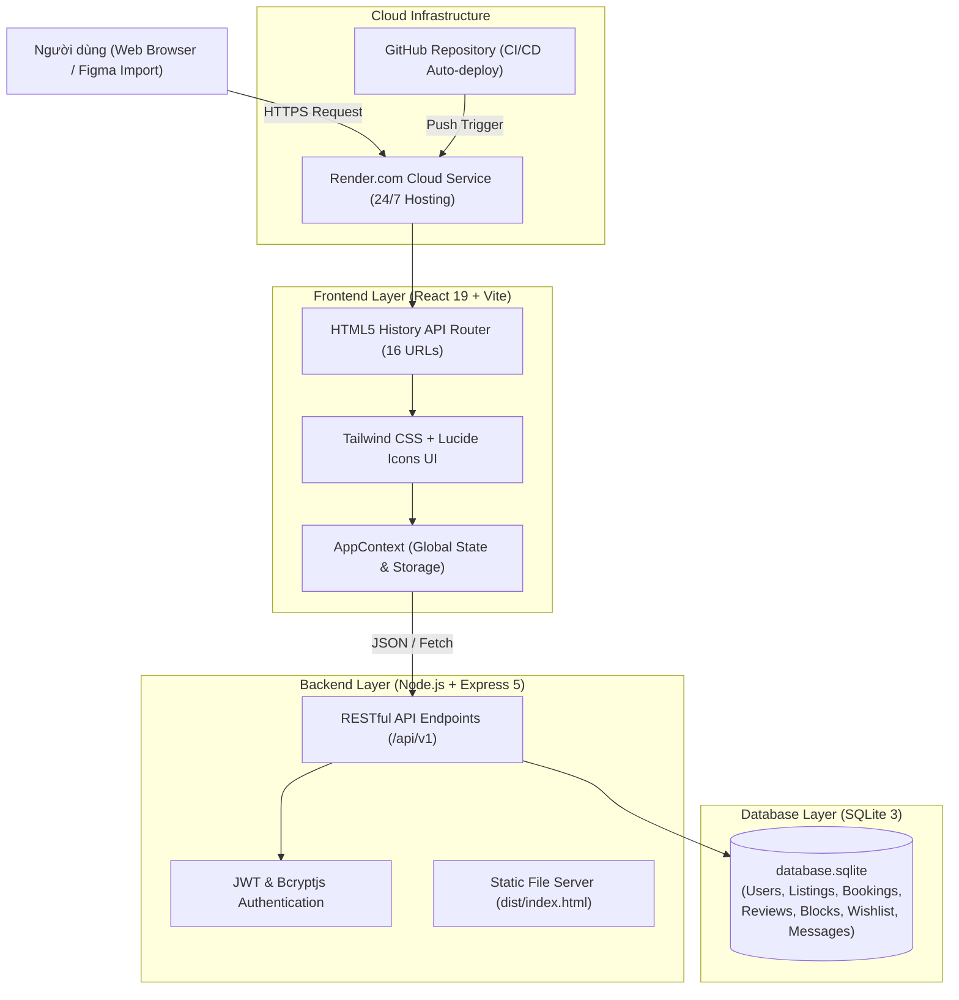
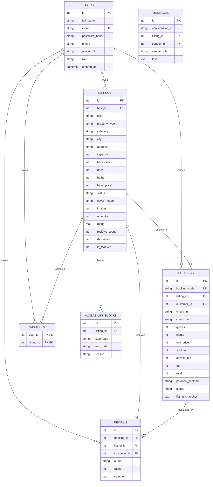

# TÀI LIỆU ĐẶC TẢ YÊU CẦU PHẦN MỀM (SRS)
## HỆ THỐNG WEBSITE ĐẶT PHÒNG TRỰC TUYẾN (AIRBNB CLONE VIỆT NAM)

* **Tên dự án**: Hệ thống Đặt phòng & Quản lý Lưu trú Trực tuyến (Airbnb Việt Nam)
* **Phiên bản**: 2.0 (Bản hoàn thiện Fullstack & Production)
* **Ngày phát hành**: 28/10/2026
* **Trạng thái**: Đã triển khai Production và hoạt động 24/7
* **Website trực tuyến**: [https://airbnb-vietnam.onrender.com/](https://airbnb-vietnam.onrender.com/)
* **Kho mã nguồn GitHub**: [https://github.com/vinh061103/airbnb-vietnam](https://github.com/vinh061103/airbnb-vietnam)

---

## 1. GIỚI THIỆU VÀ PHẠM VI DỰ ÁN

### 1.1. Bối cảnh & Mục tiêu
Dự án được xây dựng nhằm cung cấp nền tảng kết nối trực tuyến giữa **Khách hàng có nhu cầu lưu trú du lịch (Customer)** và **Chủ sở hữu chỗ ở / Homestay / Biệt thự (Host)** trên khắp các tỉnh thành du lịch tại Việt Nam (Đà Lạt, Phú Quốc, Hội An, Hồ Chí Minh, Sa Pa, Hà Nội, Đà Nẵng, Vũng Tàu, Nha Trang, v.v.).

Website hoạt động theo mô hình thực tế 100%, có cơ sở dữ liệu lưu trữ quan hệ thực tế (SQLite), hệ thống xác thực tài khoản mã hóa mật khẩu, kiểm soát trùng lịch phòng, thanh toán quét mã VietQR giả lập và hệ thống định tuyến đường link độc lập (SPA URL Routing) phục vụ liên kết với bản mẫu thiết kế trên Figma.

### 1.2. Đối tượng & Phân quyền Người dùng (Actor Matrix)

| Vai trò (Actor) | Quyền hạn và Chức năng chính |
| :--- | :--- |
| **Khách vãng lai (Guest)** | Xem trang chủ, duyệt danh mục phòng, tìm kiếm theo tiêu chí, xem chi tiết phòng và đánh giá. Phải đăng nhập để đặt phòng hoặc lưu yêu thích. |
| **Khách hàng (Customer)** | Đăng nhập/Đăng ký, tìm kiếm có lọc ngày và số khách, đặt phòng, thanh toán VietQR, quản lý đơn đặt (`/my-bookings`), đánh giá sao & nhận xét sau lưu trú, lưu danh sách yêu thích (`/wishlist`), nhắn tin với chủ nhà (`/messages`). |
| **Chủ nhà (Host)** | Xem bảng thống kê doanh thu và tỷ lệ lấp đầy (`/host/dashboard`), quản lý danh sách phòng cho thuê (`/host/listings`), tạo phòng mới (`/host/new-listing`), xem lịch và chặn ngày bận (`/host/calendar`), duyệt/quản lý đơn đặt phòng (`/host/reservations`). |

---

## 2. KIẾN TRÚC HỆ THỐNG VÀ CÔNG NGHỆ ÁP DỤNG

### 2.1. Ngăn xếp Công nghệ (Technology Stack)
* **Frontend**:
  * React 19 (Hooks, Context API, Components module hóa).
  * Vite 8.3 (Công cụ đóng gói và tối ưu build hiệu năng cao).
  * Tailwind CSS v4 (Hệ thống thiết kế giao diện UI phẳng hiện đại, tương thích chuẩn Airbnb).
  * Lucide React Icons (Thư viện icon vector sắc nét).
  * Client-side Routing qua HTML5 History API: Đồng bộ URL 16 trang độc lập cho phép copy link trực tiếp vào Figma.
* **Backend**:
  * Node.js LTS (v20.x) & Express.js 5.x.
  * RESTful API Design (Chuẩn JSON response, mã lỗi HTTP tiêu chuẩn: 200, 201, 400, 401, 404, 500).
  * CORS & JSON Middleware.
  * Bcryptjs (Mã hóa mật khẩu 10 vòng bảo mật) & JSON Web Token (JWT).
* **Cơ sở dữ liệu**:
  * SQLite 3 (`server/database.sqlite`) - CSDL quan hệ file đơn hiệu năng cao, tự động khởi tạo bảng (Schema DDL) và nạp sẵn 28 địa điểm du lịch tiêu biểu tại Việt Nam.
* **Hạ tầng Cloud**:
  * GitHub CI/CD: Tự động đồng bộ mã nguồn khi có lệnh push.
  * Render Cloud Platform: Triển khai Web Service tự động, cung cấp chứng chỉ SSL HTTPS miễn phí, hoạt động trực tuyến 24/7.

---

## 3. ĐẶC TẢ CHI TIẾT CÁC CHỨC NĂNG NGHIỆP VỤ (USE CASES)

### 3.1. Phân hệ Khách hàng (Customer)

#### UC-01: Đăng ký & Đăng nhập Hệ thống (`/login`, `/register`)
* **Mục đích**: Xác thực định danh người dùng và cấp phiên làm việc.
* **Dữ liệu đầu vào**: Họ tên, Email, Mật khẩu (tối thiểu 6 ký tự), Số điện thoại, Vai trò (Khách hàng / Chủ nhà).
* **Quy tắc nghiệp vụ**:
  * Email là duy nhất (Unique).
  * Mật khẩu được mã hóa một chiều qua hàm băm `bcrypt.hash(password, 10)`.
  * Đăng nhập thành công trả về JWT Token và chuyển hướng chính xác:
    * Tài khoản `customer` ➔ Chuyển hướng về Trang chủ (`/`).
    * Tài khoản `host` ➔ Chuyển hướng về Bảng điều khiển Host (`/host/dashboard`).

#### UC-02: Tìm kiếm & Lọc phòng theo Tiêu chí (`/search`)
* **Mục đích**: Tìm phòng trống chính xác theo nhu cầu người dùng.
* **Quy tắc kiểm tra bắt buộc (Validation)**:
  * Người dùng phải chọn đầy đủ **4 tiêu chí**:
    1. **Địa điểm**: Chọn trong danh sách hoặc gõ tên thành phố.
    2. **Ngày nhận phòng (Check-in)**: Không được trước ngày hiện tại.
    3. **Ngày trả phòng (Check-out)**: Phải sau ngày nhận phòng ít nhất 1 đêm.
    4. **Số lượng khách**: Tối thiểu 1 người.
  * *Hành vi giao diện*: Việc nhập thông tin trên thanh tìm kiếm tại Trang chủ sẽ **không tự động lọc** để giữ nguyên sự đa dạng của danh mục. Khi bấm nút **"Tìm kiếm"**, hệ thống sẽ xác thực và chuyển hướng sang trang riêng biệt: `/search`.
* **Thuật toán kiểm tra phòng trống (Availability Algorithm)**:
  * So sánh khoảng thời gian yêu cầu `[reqStart, reqEnd]` với:
    * Bảng `bookings` có trạng thái `Confirmed`.
    * Bảng `availability_blocks` do chủ nhà tự chặn.
  * Công thức va chạm lịch: `reqStart < EndDate AND reqEnd > StartDate`. Nếu thỏa mãn thì phòng đó sẽ bị loại khỏi kết quả tìm kiếm.
  * Tính trước tổng số tiền lưu trú: $\text{Tổng} = \text{Số đêm} \times \text{Đơn giá/đêm}$.

#### UC-03: Xem Chi tiết phòng (`/rooms/:id`)
* **Mục đích**: Hiển thị toàn diện hình ảnh và tiện nghi của phòng.
* **Nội dung hiển thị**:
  * Thư viện ảnh chất lượng cao.
  * Tiêu đề, loại phòng, sức chứa, số phòng ngủ, giường, phòng tắm.
  * Danh mục tiện nghi (Wifi, Điều hòa, Bếp, Hồ bơi, Máy giặt, Bồn tắm, BBQ...).
  * Điểm đánh giá trung bình (sao) và danh sách nhận xét của khách hàng trước.
  * Widget đặt phòng cố định: Tự động nhận ngày và số khách đã tìm kiếm, tính toán chi tiết:
    $$\text{Tổng tiền} = (\text{Số đêm} \times \text{Đơn giá}) + \text{Phí dịch vụ 8\%} + \text{Thuế VAT 8\%}$$

#### UC-04: Đặt phòng & Thanh toán giả lập (`/checkout`, `/confirmation`)
* **Mục đích**: Xác nhận đơn đặt phòng và ghi nhận vào cơ sở dữ liệu.
* **Quy trình thực hiện**:
  1. Kiểm tra đăng nhập (nếu chưa đăng nhập sẽ chuyển sang `/login`).
  2. Hiển thị thông tin đơn đặt: ngày, số khách, tóm tắt chi phí.
  3. Phương thức thanh toán:
     * **Mã QR VietQR (Khuyên dùng)**: Hiển thị mã QR ngân hàng mô phỏng kèm mã giao dịch duy nhất `BK-YYYY-XXXXXX`.
     * **Thẻ tín dụng / Ghi nợ**: Nhập thông tin thẻ mô phỏng.
     * **Thanh toán trực tiếp tại nơi ở**.
  4. Người dùng bấm "Xác nhận & Thanh toán":
     * Hệ thống tạo bản ghi mới trong bảng `bookings` với trạng thái `Confirmed`.
     * Tự động chuyển sang trang `/confirmation` và bắn hiệu ứng pháo hoa chúc mừng.

#### UC-05: Quản lý Chuyến đi & Hủy phòng (`/my-bookings`)
* Hiển thị toàn bộ lịch sử đơn đặt của khách.
* Cho phép hủy phòng nếu chuyến đi chưa diễn ra; khi hủy sẽ chuyển trạng thái đơn sang `Cancelled` và tự động giải phóng lịch phòng.

#### UC-06: Đánh giá & Bình luận
* Sau khi hoàn tất lưu trú, khách hàng có thể chấm điểm từ 1 đến 5 sao và để lại bình luận thực tế; hệ thống tự động cập nhật lại điểm đánh giá trung bình của chỗ ở.

#### UC-07: Danh sách Yêu thích (`/wishlist`)
* Khách hàng bấm biểu tượng trái tim để lưu nhanh hoặc bỏ lưu các phòng vào bộ sưu tập cá nhân.

---

### 3.2. Phân hệ Chủ sở hữu (Host)

#### UC-08: Tổng quan Doanh thu & Báo cáo (`/host/dashboard`)
* Hiển thị các chỉ số kinh doanh chính:
  * **Tổng doanh thu**: Tổng số tiền từ các đơn đặt phòng thành công.
  * **Số lượt đặt phòng**: Tổng số giao dịch đã được xác nhận.
  * **Tỷ lệ lấp đầy phòng**: Phần trăm số ngày phòng có khách thuê.
  * **Đánh giá trung bình**: Điểm uy tín của Host từ khách hàng.

#### UC-09: Quản lý Chỗ ở (`/host/listings`, `/host/new-listing`)
* Xem danh sách tất cả các bất động sản thuộc quyền sở hữu của Host.
* Chuyển đổi nhanh trạng thái: Đang hoạt động (`Published`) / Tạm ngưng (`Hidden`).
* Đăng phòng mới: Form nhập liệu đầy đủ thông tin, địa chỉ, sức chứa, giá tiền, ảnh và danh sách tiện nghi.

#### UC-10: Quản lý Lịch phòng & Chặn ngày (`/host/calendar`)
* Xem lịch trực quan theo tháng.
* Chủ nhà có quyền chọn ngày bắt đầu và kết thúc để chặn phòng (ví dụ để sửa chữa hoặc dùng cá nhân); hệ thống ghi nhận vào bảng `availability_blocks` và tự động khóa không cho khách đặt vào khoảng ngày này.

#### UC-11: Quản lý Đơn đặt phòng (`/host/reservations`)
* Danh sách chi tiết thông tin khách đặt, số điện thoại, ngày nhận/trả và tổng tiền thanh toán để chủ nhà tiện đón tiếp khách.

---

## 4. THIẾT KẾ CƠ SỞ DỮ LIỆU QUAN HỆ (SQLITE DATABASE SCHEMA)

Hệ thống sử dụng cơ sở dữ liệu SQLite quan hệ chuẩn hóa tại đường dẫn [`server/database.sqlite`](file:///c:/Users/ASUS/Downloads/GoSVIPver2%281280x720%29/server/database.sqlite):

---

## 5. DANH MỤC API ENDPOINTS (RESTful API)

Tất cả các API đều có tiền tố `/api/v1` và trao đổi dữ liệu qua định dạng JSON:

| Phương thức | Đường dẫn API | Mô tả chức năng | Quyền truy cập |
| :--- | :--- | :--- | :--- |
| `POST` | `/api/v1/auth/register` | Đăng ký tài khoản mới (Customer / Host) | Công khai |
| `POST` | `/api/v1/auth/login` | Đăng nhập tài khoản, trả về JWT Token | Công khai |
| `GET` | `/api/v1/listings` | Lấy danh sách chỗ ở (hỗ trợ lọc theo thành phố, danh mục) | Công khai |
| `GET` | `/api/v1/listings/:id` | Lấy thông tin chi tiết một căn phòng cụ thể | Công khai |
| `POST` | `/api/v1/listings` | Thêm chỗ ở mới | Host |
| `PATCH`| `/api/v1/listings/:id/status` | Bật/tắt trạng thái phòng (Published / Hidden) | Host |
| `GET` | `/api/v1/bookings` | Lấy danh sách đơn đặt phòng | Đã đăng nhập |
| `POST` | `/api/v1/bookings` | Tạo đơn đặt phòng mới (kiểm tra chống trùng lịch) | Customer |
| `PATCH`| `/api/v1/bookings/:id/cancel` | Khách hàng hủy đơn đặt phòng | Customer |
| `GET` | `/api/v1/reviews` | Lấy danh sách đánh giá của phòng | Công khai |
| `POST` | `/api/v1/reviews` | Gửi đánh giá và chấm điểm sao mới | Customer |
| `GET` | `/api/v1/availability/blocks` | Lấy danh sách các ngày bị chặn của chỗ ở | Công khai |
| `POST` | `/api/v1/availability/block` | Chủ nhà thêm khoảng ngày chặn | Host |
| `DELETE`| `/api/v1/availability/block/:id`| Chủ nhà mở khóa lại ngày chặn | Host |
| `GET` | `/api/v1/messages` | Lấy danh sách tin nhắn trao đổi | Đã đăng nhập |
| `POST` | `/api/v1/messages` | Gửi tin nhắn mới giữa khách và chủ nhà | Đã đăng nhập |

---

## 6. SITEMAP & BẢN ĐỒ ĐƯỜNG LINK (PHỤC VỤ FIGMA & THUYẾT TRÌNH)

Hệ thống định tuyến SPA Router cấp phát 16 đường link độc lập, có thể nhập trực tiếp vào trình duyệt hoặc công cụ import Figma (`html.to.design`):

1. **Trang chủ**: `https://airbnb-vietnam.onrender.com/`
2. **Kết quả tìm kiếm**: `https://airbnb-vietnam.onrender.com/search`
3. **Chi tiết Biệt thự cao cấp**: `https://airbnb-vietnam.onrender.com/rooms/101`
4. **Chi tiết Homestay ấm cúng**: `https://airbnb-vietnam.onrender.com/rooms/102`
5. **Thanh toán VietQR & Đặt phòng**: `https://airbnb-vietnam.onrender.com/checkout`
6. **Xác nhận đặt phòng thành công**: `https://airbnb-vietnam.onrender.com/confirmation`
7. **Trang Đăng nhập**: `https://airbnb-vietnam.onrender.com/login`
8. **Trang Đăng ký tài khoản**: `https://airbnb-vietnam.onrender.com/register`
9. **Chuyến đi của tôi**: `https://airbnb-vietnam.onrender.com/my-bookings`
10. **Danh sách yêu thích**: `https://airbnb-vietnam.onrender.com/wishlist`
11. **Tin nhắn trò chuyện**: `https://airbnb-vietnam.onrender.com/messages`
12. **Bảng điều khiển Chủ nhà**: `https://airbnb-vietnam.onrender.com/host/dashboard`
13. **Danh sách phòng của Host**: `https://airbnb-vietnam.onrender.com/host/listings`
14. **Đăng phòng mới**: `https://airbnb-vietnam.onrender.com/host/new-listing`
15. **Lịch chặn ngày của Host**: `https://airbnb-vietnam.onrender.com/host/calendar`
16. **Quản lý đơn đặt phòng Host**: `https://airbnb-vietnam.onrender.com/host/reservations`

---

## 7. YÊU CẦU PHI CHỨC NĂNG (NON-FUNCTIONAL REQUIREMENTS)

1. **Hiệu năng & Tốc độ tải trang (Performance)**:
   * Bản build Vite được đóng gói tối ưu với gzip dưới 120KB JavaScript, thời gian render trang đầu dưới 1.5 giây.
   * Cơ sở dữ liệu SQLite xử lý truy vấn đọc/ghi nội bộ siêu nhanh dưới 15ms.
2. **Tính bảo mật (Security)**:
   * Mật khẩu người dùng bắt buộc mã hóa qua `bcryptjs` với salt 10 vòng, không lưu mật khẩu thô trong cơ sở dữ liệu.
   * Truyền tải qua giao thức HTTPS bảo mật của Render Cloud.
3. **Độ tương thích & Responsive**:
   * Giao diện tương thích hoàn hảo từ màn hình di động (Mobile: 375px), Máy tính bảng (Tablet: 768px) đến Màn hình máy tính (Desktop: 1280x720 và 1920x1080).
4. **Độ tin cậy & Sẵn sàng (Reliability & Availability)**:
   * Website duy trì hoạt động trực tuyến 24/7 trên Render Cloud mà không phụ thuộc vào máy tính cá nhân.
   * Tự động khởi tạo lại dữ liệu nếu file database bị trống.
